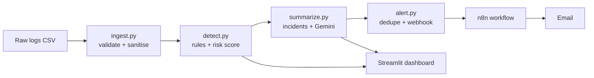

# AI Cyber Patrol Agent

A small log-monitoring agent: it reads login logs, flags suspicious activity with transparent rules, asks Gemini to write a short incident summary, and sends an **alert-only** email through n8n. It never blocks anything automatically.

- **Live demo (synthetic data):** https://cyber-petrolling1319.streamlit.app
- **Demo video (~2 min):** https://drive.google.com/file/d/1hSyohiGiptiahk9Bgaw07Giig4tXtHUf/view?usp=drivesdk

> The live demo runs on synthetic sample data and sends no emails. The full pipeline (Gemini + n8n + email) runs locally.

## What it does

1. **Ingest** raw login events (CSV), validate and normalise them, reject malformed rows.
2. **Detect** suspicious behaviour with rule-based scoring (0 to 100). Scores are computed by code, never by the LLM.
3. **Summarise** each incident with Gemini (retry with backoff, deterministic fallback if the API is down).
4. **Alert** through an n8n webhook to email. Duplicate alerts are suppressed.
5. **Review** everything in a Streamlit dashboard.



## Detection rules

| Rule | Points |
|---|---|
| 5+ failed logins for one user within 10 minutes | 40 |
| 5+ failed logins from one IP within 24 hours (slow attacks, spraying) | 40 |
| Successful login right after 5+ failures | 40 |
| Login from a country not in the user's baseline | 25 |
| Login from an IP not in the user's baseline | 20 |
| Login at an odd hour (before 06:00 or from 22:00) | 15 |

Scores are summed and capped at 100. Levels: **low** below 40, **medium** 40 to 69, **high** 70 and above. Events are grouped into incidents per (user, IP) with a 10-minute gap. Emails are sent for incidents scoring 70 or more; lower ones appear only in the dashboard.

## Safety design

- **Alert only.** No automatic blocking. Suggested next steps (reset password, revoke sessions, block IP at the firewall) are recommendations for a human.
- **Scores come from rules**, not from Gemini. The Gemini text is labelled as non-final and needs human review.
- **Gemini failure handling.** Up to 5 retries with exponential backoff, then a rule-based fallback summary (`source = fallback_rules`).
- **Input hardening.** Control characters are stripped, cells starting with `=`, `+`, `-` or `@` are neutralised against CSV injection, email subjects are stripped of newlines against header injection.
- **Duplicate prevention.** Each incident key (`user|ip|first_seen`) is stored in `data/sent_alerts.json`; `--force` bypasses it.
- **Secrets** live in `.env`, which is git-ignored. Use `.env.example` as a template.

## Setup (Windows, PowerShell)

```powershell
git clone https://github.com/ztsprofessionalaiid7-alt/cyber-petrolling.git
cd cyber-petrolling
python -m venv venv
venv\Scripts\activate
pip install -r requirements.txt
copy .env.example .env     # then fill in GEMINI_API_KEY and N8N_WEBHOOK_URL
```

Run the pipeline:

```powershell
python generate_logs.py     # synthetic logs
python ingest.py
python detect.py
python summarize.py
python alert.py             # add --force to resend
streamlit run app.py
```

**n8n:** run n8n locally (Docker), create a Webhook node feeding an email (Gmail SMTP with an App Password) node, and put the webhook URL in `.env`. With the test URL you must click "Listen for test event" before each alert, otherwise the webhook returns 404.

## Tests

Two separate sets, reported separately on purpose.

### Development set: 25 cases, 25/25 passing

Built from real sshd logs in the public [Loghub](https://github.com/logpai/loghub) OpenSSH dataset (LabSZ server, December 2015).

| Group | Cases | What it checks |
|---|---|---|
| E01 to E10 | 10 | Clear attack and clear benign IPs |
| H11 to H15 | 5 | Hard cases: password spraying, slow attacks, mixed users |
| H16 | 1 | Shuffled input gives the same result |
| M17 to M19 | 3 | Malformed rows rejected (missing IP, bad timestamp, invalid IP) |
| U20 to U22 | 3 | Empty file, unknown event type, missing column |
| R23 to R25 | 3 | CSV injection, shell/SQL/header injection, prompt injection cannot change the score |

Labelling rule: an IP with 5 or more failed logins is an **attack** (must score 40 or more); an IP with at most 1 failure, or only successes, is **benign** (must score below 40).

History, stated plainly: the first full run passed 24/25. H14 (5 failed logins from one IP spread over 3 hours) failed because the per-user rule only looked at 10 minutes. I added the per-IP 24-hour rule, after which 25/25 pass. Because the label rule and that fix share the same idea ("many failures from one IP"), the development result is partly circular. The hidden set below is the more honest number.

```powershell
python -m pytest tests -v
```

### Hidden set: 10 cases, run once, 6/10 passing

Built from a different slice of the same log (lines 100,000 to 130,000), with IPs already used in the development set excluded. 5 attack and 5 benign IPs, chosen by a fixed seed. It was run **once**, after the detector was frozen, and the code was not changed afterwards.

| Case | Label | Failed logins | Result | Score |
|---|---|---|---|---|
| X01 | attack | 5 (spread over 3 days) | **missed** | 15 |
| X02 | attack | 6 | pass | |
| X03 | attack | 10 | pass | |
| X04 | attack | 24 | pass | |
| X05 | attack | 4128 | pass | |
| X06 | benign | 1 | **false alarm** | 40 |
| X07 | benign | 1 | pass | |
| X08 | benign | 1 | **false alarm** | 55 |
| X09 | benign | 0 (success only) | pass | |
| X10 | benign | 1 | **false alarm** | 55 |

Attacks caught: 4 of 5. Benign IPs correctly left alone: 2 of 5.

**Why it failed** (confirmed with `tests/diagnose.py`):

- **False alarms (X06, X08, X10).** The per-user rule counts failures for a username regardless of which IP they came from. During a flood against `root` or `admin`, an innocent IP that failed once is scored as if it were part of the attack. X10 was scored on 567 failures for `root` in 10 minutes, almost all from another IP. X08 and X10 also got +15 for the odd hour.
- **Missed attack (X01).** Five failures from one IP spread over three days never fall inside a 24-hour window. The labelling rule had no time limit, but the detector does.

Practical impact: the worst false alarm scored 55, below the email threshold of 70, so none of them would have produced an email. They would show as *medium* in the dashboard.

```powershell
# Rebuild and run the hidden set (do this only once, with the detector frozen)
python tests\build_holdout.py data\real\OpenSSH_slice2.log 2015
python -m pytest tests -m holdout -v
```

The full log comes from the Loghub OpenSSH `SSH.tar.gz` on Zenodo (record 8196385).

## Limitations

- **Per-user rule is not IP-aware.** It can blame an innocent IP when many other IPs attack the same account (see hidden-set results).
- **Very slow attacks** spread over more than 24 hours are not detected.
- **Labels are rule-defined by the author**, not ground truth. The development result is partly circular.
- **Public dataset gaps.** Loghub OpenSSH has no country data (all `UNKNOWN`, so the new-country rule never fires on it) and no year (2015 is assumed).
- **Medium-risk incidents are not emailed** (threshold is 70).
- **Gemini availability.** The API sometimes returns 503; the fallback summary is simpler.
- The live demo uses synthetic data and cannot send alerts.

## Roadmap

- Count failures per (user, IP) pair instead of per user, then re-measure on a fresh hidden set from a different part of the log.
- A longer window (for example 7 days) for slow attacks, with matching labels.
- Real GeoIP lookup for country data.

## Project layout

```
generate_logs.py   synthetic log generator
parse_openssh.py   converts Loghub OpenSSH logs to CSV
ingest.py          validation and sanitising
detect.py          rules and risk score
summarize.py       incident grouping and Gemini summary
alert.py           dedupe and n8n webhook
app.py             Streamlit dashboard (demo_data/ used when data/ is absent)
tests/             25 development cases, hidden-set builder and tests, diagnose.py
```
